<p align="center">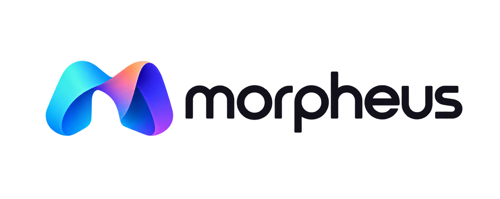</p>

<p align="center">
  🏆 <b>1st Place @ OpenAI DevDay Exchange Community Hackathon, London</b><br/>
  <sub>1 November 2026 · Built in one day · An event with 1,000+ applicants</sub>
</p>

<p align="center">
  <b>Scan your room. Morph it into a simulation. Watch real robots do your chores in it.</b><br/>
  <sub>Gaussian splat → collision world → SimReady objects → planned robot rollouts → an honest verdict on which robot fits your home.</sub>
</p>

<p align="center">
  
  
  
  
  
  
  
  
</p>

<p align="center">
  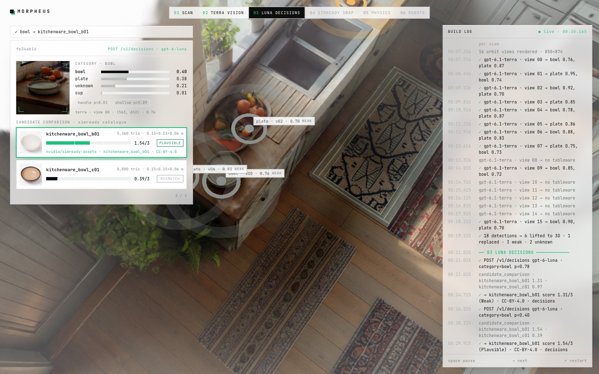
</p>

---

## ▍The problem

Robots are about to move into homes. The question stops being *"can a robot do chores?"* and becomes **"which robot can do *my* chores, in *my* kitchen?"** Spec sheets can't answer that. Your counter height, your aisle width and where your sink actually is can.

Morpheus takes a phone-grade capture of a room and turns it into something a robot can be dropped into. Then it lets several robots attempt the same household task inside it, from the robot's own camera, and records which steps each one could and couldn't do.

## ▍The pipeline at a glance

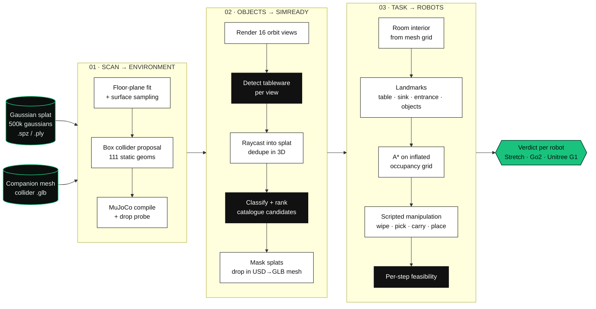

| Stage | Model | What it decides |
| --- | --- | --- |
| **Terra vision** | `gpt-6.1-terra` via the Responses API, or `gpt-6-astra` subagents via `codex exec` | Which pixels in each rendered view are a plate, bowl, mug, cup, glass or spoon |
| **Luna decisions** | `gpt-6-luna` via `POST /v1/decisions` | The object's category (with probabilities), handle/shallow predicates, and a 0–3 match score for every catalogue candidate |
| **Feasibility** | `gpt-6-luna` predicates | Whether each manipulation step is plausible for the chosen robot body |

---

## ▍The demo

The app opens straight into the show. Every number on screen is read from data recorded in this repository: the scan, the terra detections, the luna traces, the SimReady meshes, the MuJoCo report and the planned rollouts.

<table>
<tr>
<td width="50%">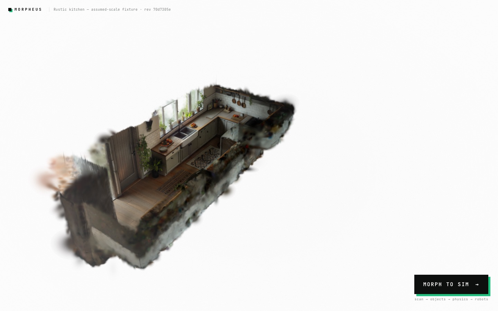<br/><sub><b>00 · BLOOM.</b> Click the kitchen. Half a million gaussians reveal through an expanding sphere mask while the camera dollies in.</sub></td>
<td width="50%">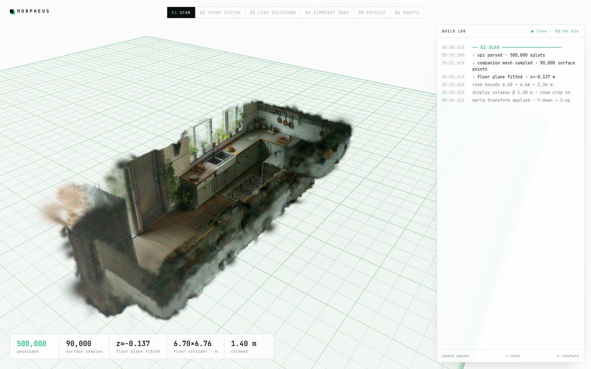<br/><sub><b>01 · SCAN.</b> Floor plane fitted on a tilted capture, 90k surface samples, room crop and cutaway.</sub></td>
</tr>
<tr>
<td>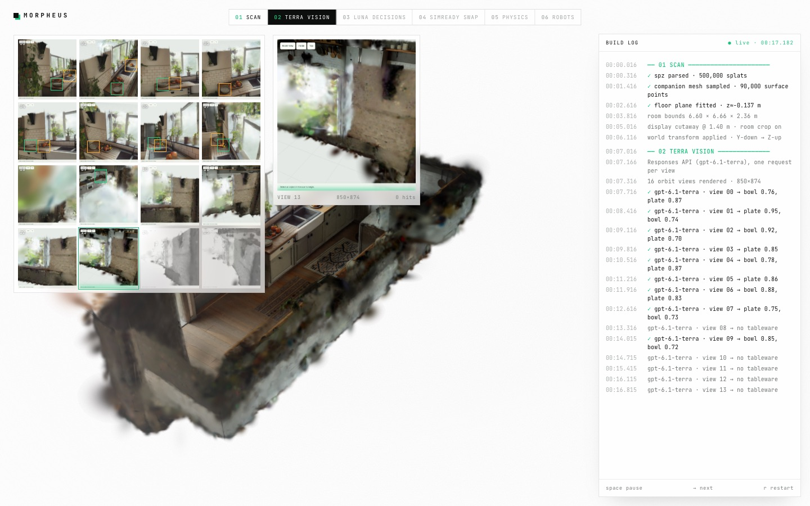<br/><sub><b>02 · TERRA VISION.</b> Sixteen orbit renders, one vision request each. Brackets are the model's own pixel detections.</sub></td>
<td><br/><sub><b>03 · LUNA DECISIONS.</b> Category probabilities, then every NVIDIA candidate scored. Only matches ≥ 0.5 / 3 are accepted.</sub></td>
</tr>
<tr>
<td>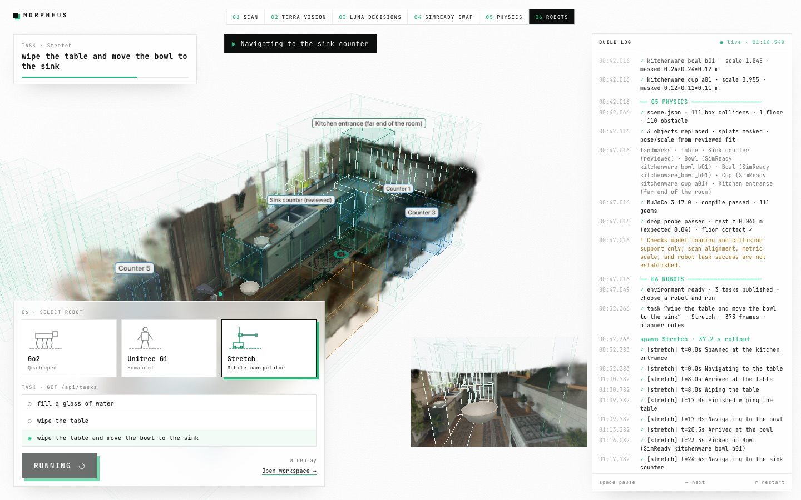<br/><sub><b>06 · ROBOTS.</b> Stretch carries the swapped-in SimReady bowl to the sink. The inset is the robot's own camera.</sub></td>
<td>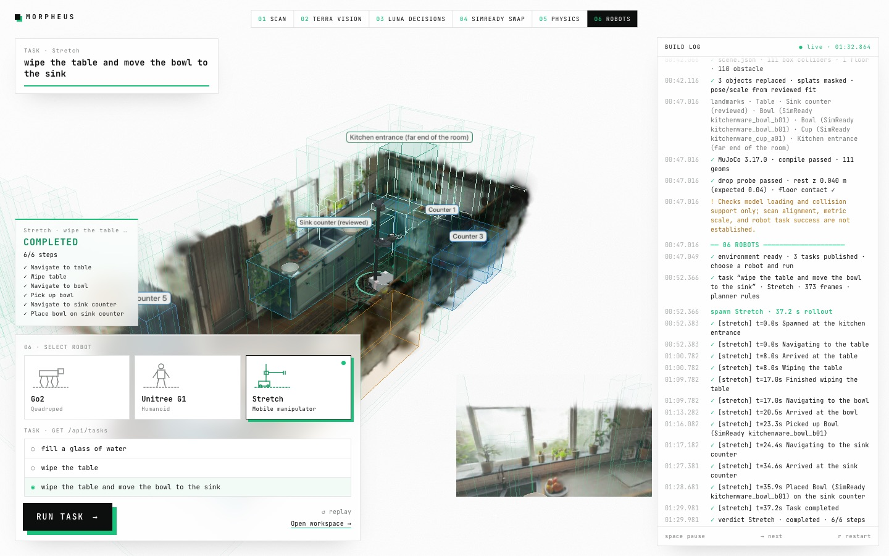<br/><sub><b>VERDICT.</b> Six of six steps completed. Run Go2 and G1 on the same chore and the verdicts stack up side by side.</sub></td>
</tr>
</table>

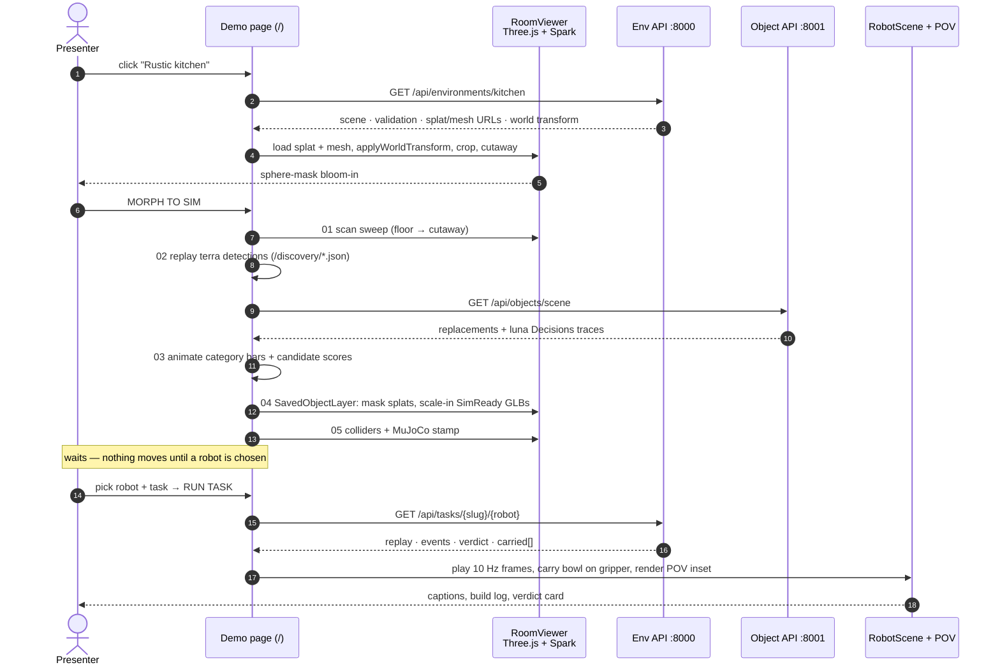

**Controls:** `Space` pause / start · `→` next phase · `R` restart. In the workspace, `F` toggles a creative-mode fly camera (WASD, Space/Shift, mouse look, wheel for speed).

---

## ▍Architecture

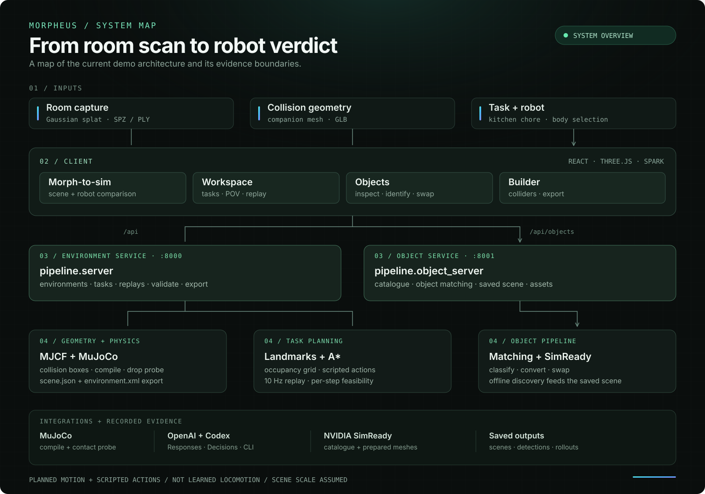

The environment service serves scenes and planned replays and validates MJCF with MuJoCo. The object service manages catalogue matching and saved replacements. Object discovery can also run offline. Robot routes and manipulation are planned or scripted; they are not learned locomotion. The sample scene's scale is assumed.

<sub>Visual direction inspired by [Supabase's architecture diagrams](https://supabase.com/docs/guides/getting-started/architecture).</sub>

**Committed state the client reads:** `output/kitchen/scene.json` (111 colliders) · `rollouts/kitchen/*` (3 tasks × 3 robots) · `output/simready/` (prepared meshes + saved scene with Decisions traces) · `public/discovery/` (16 views + detections) · `src/robots/*.glb` (MuJoCo Menagerie meshes).

### Object discovery → SimReady swap

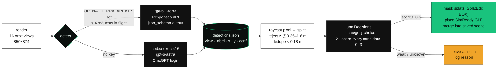

The API-key policy is deliberate: the main key only calls **Decisions**. Detection uses either a separate terra-only key (the code refuses any non-terra model on that path) or the Codex CLI login. Nothing above terra is ever called with an API key.

### Task planning

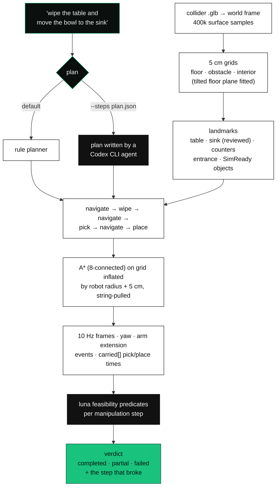

| Robot | Body | Reach | Bowl chore |
| --- | --- | --- | --- |
| **Stretch 3** | wheeled mobile manipulator, telescoping arm | 0.52 m, 0.15–1.10 m height | ✅ completed · 6 / 6 steps |
| **Unitree G1** | humanoid | 0.50 m, 0.30–1.45 m height | ✅ completed |
| **Unitree Go2** | quadruped, no arm | — | ⚠️ partial · reaches the table, cannot wipe |

Every frame of every committed rollout is tested to stay inside the room interior with full footprint clearance from the mesh.

---

## ▍Run it

Requirements: Node 24, Python 3.12, a WebGL2 browser (Chrome).

```sh
git clone https://github.com/bede-lau/Morpheus && cd Morpheus
npm ci
npm run fetch-sample                                    # World Labs kitchen splat + collider (checksummed)
uv venv pipeline/.venv
uv pip install --python pipeline/.venv/bin/python -r requirements.txt
```

```sh
npm run dev                                             # http://127.0.0.1:5174
pipeline/.venv/bin/python -m pipeline.server            # :8000  environments · tasks · MuJoCo
pipeline/.venv/bin/python -m pipeline.object_server     # :8001  SimReady objects · Decisions
```

| URL | What |
| --- | --- |
| `/` | The demo: blank canvas → bloom → morph to sim → robots |
| `/?view=workspace` | Task runner, robot POV, verdicts, compare, fly camera |
| `/?view=objects` | Manual select → identify with Decisions → replace |
| `/?view=builder` | Collider editing, scale calibration, MuJoCo validate/export |

**No key needed to run the demo.** Rollouts, detections, Decisions traces, prepared meshes and the saved object scene are all committed. Keys only matter for producing new data:

```sh
# .env
OPENAI_API_KEY=sk-...           # Decisions only (gpt-6-luna): matching + feasibility notes
OPENAI_TERRA_API_KEY=sk-...     # optional, terra-class vision only
```

### Regenerate the data

```sh
# object discovery: render → detect (terra API or Codex subagents) → apply
python3 scripts/discover-objects.py render --views 16
python3 scripts/discover-objects.py detect             # --backend api|codex
python3 scripts/discover-objects.py apply              # Decisions match, replace, merge-save

# task rollouts for all robots
pipeline/.venv/bin/python -m pipeline.task_planner "wipe the table and move the bowl to the sink" --all
pipeline/.venv/bin/python -m pipeline.task_planner "fill a glass of water" --all --steps plan.json

# inspect what the planner sees
pipeline/.venv/bin/python -m pipeline.landmarks
```

### Tests

```sh
npm test                                                                   # 43 TypeScript
pipeline/.venv/bin/python -m unittest discover -s tests -p 'test_*.py'     # 34 Python
npm run build
```

Coverage includes collider proposal and export, native MuJoCo floor contact, browser-vs-native MJCF parity, revision-bound replays, landmark and spawn placement, rollout-inside-room clearance, pick/carry/place timing, POV eye pose, fly-camera math and SimReady scene persistence.

---

## ▍Repository map

```
Morpheus/
├── src/
│   ├── demo.tsx · demo-fx.ts          morph-to-sim show (route /)
│   ├── red-pill.tsx                   opening screen
│   ├── workspace.tsx                  task runner UI
│   ├── viewer.ts · cutaway.ts         Three.js + Spark room viewer, display-only crop/cutaway
│   ├── robot-scene.ts · robot-model.ts  articulated Menagerie robots, gait, carry
│   ├── pov.ts · fly.ts                robot camera inset, creative-mode fly cam
│   ├── saved-objects.ts · object-scene.ts  SimReady meshes + splat masks
│   └── robots/                        Stretch 3 · Go2 · G1 GLBs + joint sidecars
├── pipeline/
│   ├── server.py · read_api.py · task_api.py   :8000
│   ├── object_server.py · simready.py          :8001, Decisions, USD → GLB
│   ├── room_mesh.py · landmarks.py · task_planner.py
│   └── export.py                      MJCF + validation
├── scripts/discover-objects.py        render / detect / apply
├── rollouts/kitchen/                  committed rollouts (3 tasks × 3 robots)
├── output/                            scene.json, SimReady prepared meshes, discovery record
└── docs/                              contracts, API, demo script
```

| Doc | |
| --- | --- |
| [docs/DEMO.md](docs/DEMO.md) | 90-second script with talking points |
| [docs/TASKS.md](docs/TASKS.md) | Task-stage contract: robots, envelope, landmarks, carry, API policy |
| [docs/CONTRACT.md](docs/CONTRACT.md) | Environment handoff: MJCF, manifest schema, frames, validation meaning |
| [docs/READ_API.md](docs/READ_API.md) | HTTP routes for environments, replays and tasks |
| [docs/ASSETS.md](docs/ASSETS.md) | Provenance and licensing for every asset |
| [docs/UI_HANDOFF.md](docs/UI_HANDOFF.md) | Workspace UI internals |

### Drop the room into your own MuJoCo scene

```python
import mujoco
model = mujoco.MjModel.from_xml_path("scene.xml")   # from the exported bundle
```

```xml
<mujoco> <include file="environment.xml"/> <!-- your robot here --> </mujoco>
```

Metres, right-handed, Z-up, WXYZ quaternions, static geoms prefixed `env_`. Details in [CONTRACT.md](docs/CONTRACT.md).

---

## ▍What this is, and isn't

We'd rather be precise than impressive.

- The kitchen is a **synthetic World Labs capture** with a companion mesh, not a measured scan of a real home. Scale is assumed.
- Rollouts are **planned motions checked against the room geometry**, not physics simulations or trained policies. A verdict says which steps are geometrically and kinematically plausible for a body, not that a robot will succeed.
- Landmarks are inferred from geometry. The sink was pinned by a person after looking at the scan, and the UI says so.
- SimReady swaps are **visual + static collision** replacements. Mass, articulation and grasp quality are not validated.
- The table bowl sits slightly past Stretch's nominal reach; the pick uses a declared 0.20 m gripper allowance, shown in the step note.

## ▍Credits

| | |
| --- | --- |
| Gaussian splat rendering | [Spark](https://github.com/sparkjsdev/spark) |
| 3D | [Three.js](https://github.com/mrdoob/three.js) |
| Physics | [MuJoCo](https://github.com/google-deepmind/mujoco) |
| Robot models | [MuJoCo Menagerie](https://github.com/google-deepmind/mujoco_menagerie): Hello Robot Stretch 3 (Clear BSD), Unitree Go2 and G1 (BSD-3-Clause) |
| Objects | [NVIDIA SimReady Assets](https://huggingface.co/datasets/nvidia/simready-assets) (CC-BY-4.0) |
| Sample room | [World Labs — Rustic kitchen with natural light](https://docs.worldlabs.ai/marble/export/specs) (not redistributed; fetched by script) |
| Models | OpenAI Decisions API (`gpt-6-luna`), Responses API (`gpt-6.1-terra`), Codex CLI (`gpt-6-astra`) |

<p align="center"><sub>Built in one day at the OpenAI DevDay Community Hackathon, London, 1 November 2026, with Codex.</sub></p>

